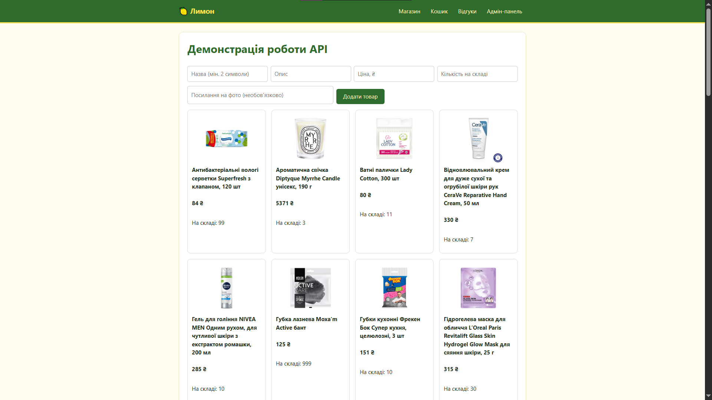
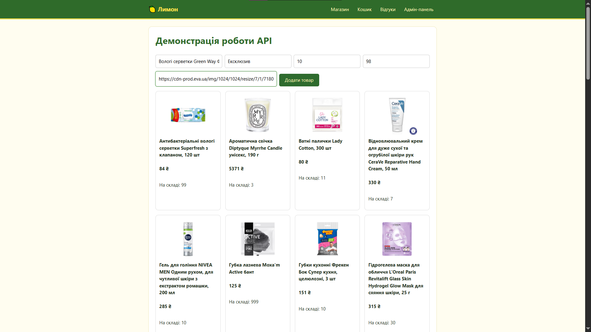
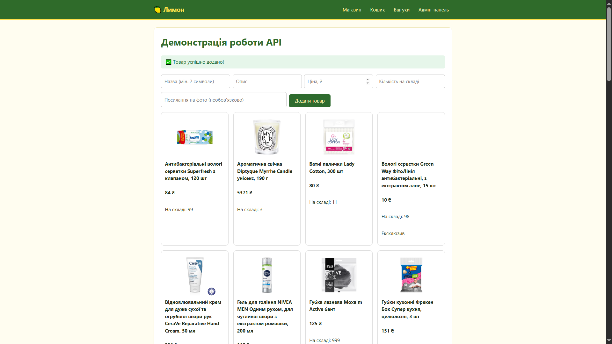
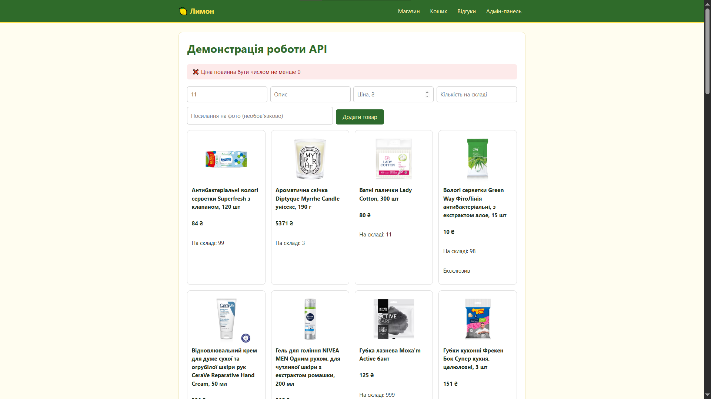
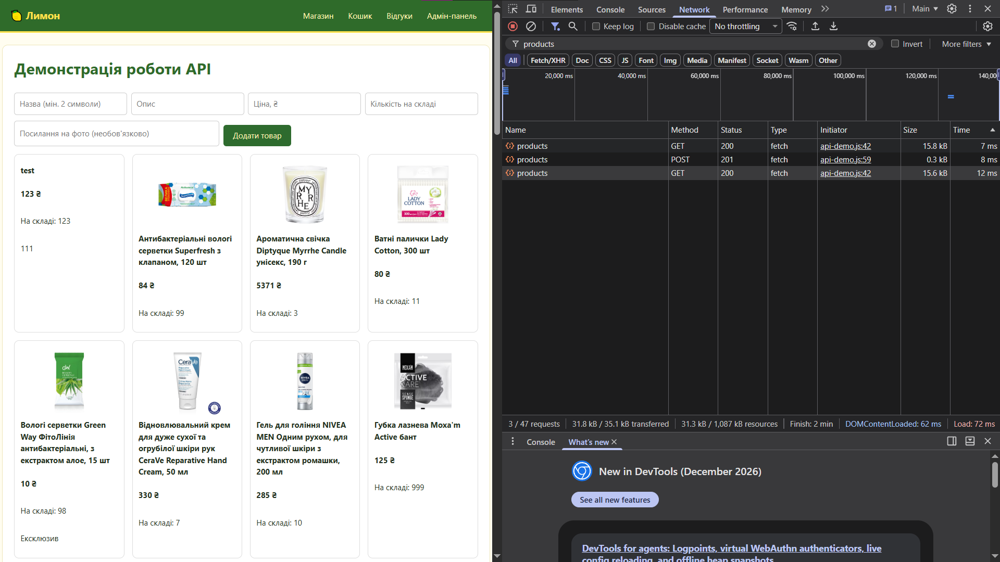

# Лабораторна робота 06. Клієнтська частина для REST API

ПІБ: Конашук Владислав Сергійович
Група: ІПЗ-21
Склад команди: 1 особа (В.Конашук)
Тема проєкту: Інтернет магазин: Лимон
Репозиторій: https://github.com/rotdreamz/laboratorna06

## 1. Особистий внесок

Роботу виконано індивідуально на основі проєкту лабораторної роботи 5 (копія проєкту, новий репозиторій). **Під час виконання я використовував ШІ-асистента Claude** як помічника: він пропонував заготовки коду для `templates/api-demo.html` і `static/js/api-demo.js`, підказував кроки роботи з Git і GitHub, способи відтворення помилок та зйомки скріншотів у DevTools, а також допоміг скласти структуру цього звіту. Увесь код я вставляв у проєкт, запускав, перевіряв і виправляв самостійно (див. розділ «Труднощі»). Результат роботи я розумію і можу пояснити.

Що зроблено:

- створено новий репозиторій і перенесено до нього код лабораторної 5 (без `venv` і старого `.git`);
- додано маршрут `/api-demo` в `app.py` та шаблон `templates/api-demo.html`, який успадковує `base.html`;
- написано `static/js/api-demo.js`: завантаження списку товарів (`GET`) і додавання нового товару (`POST`) через `fetch` та `async/await`;
- реалізовано валідацію форми на стороні клієнта (назва, ціна, кількість);
- реалізовано повідомлення про успіх і помилку, індикатор завантаження та обробку `response.ok`;
- оформлено сторінку в стилі сайту (зелена кнопка, картки товарів, адаптивна сітка).

Коміти:

- `Додано сторінку api-demo з fetch і формою`: `app.py`, `templates/api-demo.html`, `static/js/api-demo.js`;
- `Додано README та скріншоти до лаби 6`: звіт і папка `lab_report/screenshots/`.

Уся історія комітів: https://github.com/rotdreamz/laboratorna06/commits/main

## 2. Опис сторінки і технології

Сторінка `/api-demo` звертається до REST API магазину з лабораторної 5 за допомогою `fetch` та `async/await`. Вона показує список товарів, отриманий з API, і дозволяє додати новий товар через форму. Користувач бачить повідомлення про успіх або помилку, а під час запитів показується індикатор завантаження. Сторінку й API віддає один і той самий Flask-сервер, тому CORS налаштовувати не потрібно.

Технології: Python 3, Flask 3.1, SQLite, HTML, CSS, JavaScript (Fetch API, async/await), Git і GitHub, Visual Studio Code, DevTools браузера.

Розміщення файлів:

- HTML-шаблон: `templates/api-demo.html`;
- JavaScript: `static/js/api-demo.js`;
- маршрут сторінки: `/api-demo` у файлі `app.py`.

Запуск:

```
python -m venv venv
venv\Scripts\activate
pip install -r requirements.txt
python app.py
```

Сторінка: `http://127.0.0.1:5000/api-demo`, API: `http://127.0.0.1:5000/api/products`.

## 3. Ендпоінти API, які використовує сторінка

| № | Метод | Адреса | Призначення | Коди відповідей |
|---|-------|--------|-------------|-----------------|
| 1 | GET | `/api/products` | отримати список усіх товарів | 200 |
| 2 | POST | `/api/products` | створити новий товар | 201, 400 |

Поля товару:

- `name`: назва (обов'язкове, непорожній рядок, на формі мінімум 2 символи);
- `price`: ціна (число не менше 0);
- `stock`: кількість на складі (ціле число не менше 0);
- `description`: опис (необов'язкове);
- `image`: посилання на фото (необов'язкове).

У відповіді API також є поля `id`, `delivery`, `sale_price`, `sale_color`.

Приклад запиту, який відправляє сторінка (POST `/api/products`):

```json
{
  "name": "test",
  "description": "",
  "price": 123,
  "stock": 123
}
```

## 4. Валідація та обробка помилок

Валідація на стороні клієнта (функція обробки форми в `api-demo.js`):

- `name`: мінімум 2 символи після `trim()`;
- `price`: обов'язкове число не менше 0;
- `stock`: ціле число не менше 0 (порожнє значення вважається 0);
- `image`: додається в запит лише якщо поле заповнене.

Обробка помилок:

- `fetch` не вважає відповіді 400 чи 404 помилкою, тому після кожного запиту перевіряється `response.ok`;
- якщо API повертає `{"error": "..."}`, цей текст показується користувачу (функція `getErrorText`);
- якщо сервер недоступний, `fetch` відхиляє проміс, і користувач бачить повідомлення про помилку замість «зависання» сторінки;
- індикатор завантаження вимикається в блоці `finally` за будь-якого результату;
- дані від користувача виводяться через `textContent`, а не `innerHTML`, тому введений HTML-код не виконується на сторінці.

## 5. Скріншоти

**Список товарів**



**Додавання товару (заповнена форма)**



**Повідомлення про успіх**



**Повідомлення про помилку (валідація)**




**Повідомлення про помилку (сервер недоступний)**


**Запити в DevTools (Network)**



## 6. Тестування сторінки

Сторінку перевірено вручну за такими сценаріями:

| № | Сценарій | Очікуваний результат | Результат |
|---|----------|----------------------|-----------|
| 1 | Відкриття сторінки | список товарів завантажується (GET, 200) | пройдено |
| 2 | Додавання товару з коректними даними | POST 201, зелене повідомлення, товар у списку | пройдено |
| 3 | Назва з 1 символу | червоне повідомлення, запит не відправляється | пройдено |
| 4 | Порожня ціна | червоне повідомлення, запит не відправляється | пройдено |
| 5 | Вимкнений сервер, натискання «Додати товар» | червоне повідомлення про помилку | пройдено |

У вкладці Network видно послідовність `GET 200` → `POST 201` → `GET 200`: завантаження списку, створення товару й повторне завантаження списку після додавання.

## 7. Труднощі та їх вирішення

- Після копіювання проєкту лабораторної 5 у нову папку лишався старий `.git` → видалив його й ініціалізував новий репозиторій, щоб `git push` не йшов у репозиторій лаби 5.
- При додаванні маршруту `/api-demo` я випадково замінив старий код у кінці `app.py`, і зникли маршрут `/` та запуск сервера (`app.run`) → відновив усі три блоки: `index`, `api_demo` і `if __name__ == '__main__'`.
- На порожній формі кнопка спочатку була фіолетовою й не відповідала стилю сайту → змінив кольори кнопки на зелені.
- Повідомлення про успіх і помилку зникають через 5 секунд, тому скріншоти доводилось робити одразу після дії (`Win+Shift+S`).
- У вкладці Network спочатку не було колонки Method → увімкнув її через контекстне меню заголовка таблиці.

## 8. Висновки

У ході роботи я підключив клієнтську частину до власного REST API за допомогою `fetch` та `async/await`: сторінка отримує список товарів і додає нові через форму. Я зрозумів, що `fetch` не вважає відповіді 400 чи 404 помилкою, тому обов'язково перевіряв `response.ok` і показував користувачу текст помилки з API. Для безпеки дані від користувача виводяться через `textContent`, а не `innerHTML`. Окремо я перевірив поведінку сторінки при помилках валідації та при вимкненому сервері, а за допомогою вкладки Network побачив реальні запити `GET` і `POST`. Під час роботи я використовував ШІ-асистента Claude як допоміжний інструмент, а результат перевіряв самостійно.