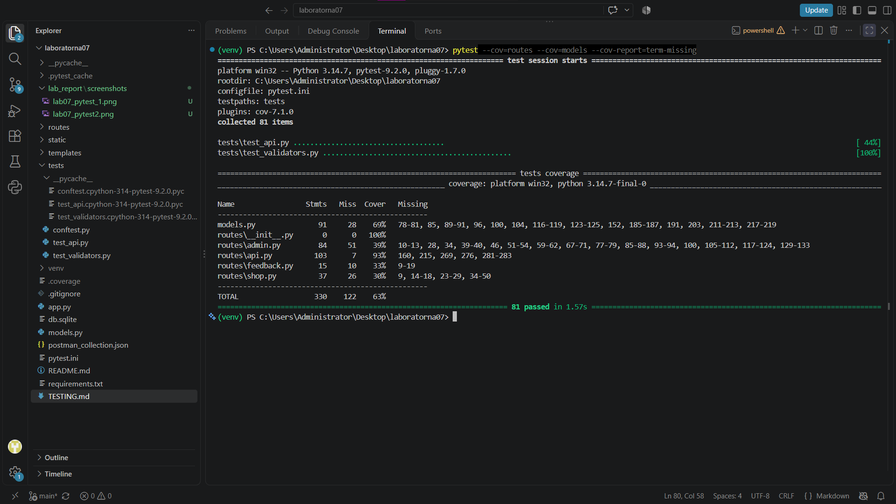

# Тестування (Лабораторна робота 07)

## Запуск тестів

```bash
pip install pytest pytest-cov
pytest -v
pytest --cov=routes --cov=models --cov-report=term-missing
```

Структура:

```
tests/
├── conftest.py         # fixtures: app, client, product (тимчасова БД)
├── test_validators.py  # unit тести validate_product
└── test_api.py         # integration тести /api/products
pytest.ini
```

## Ізоляція від робочої бази

Fixture `app` у `conftest.py` підставляє `app.config['DATABASE'] = tmp_path / 'test.db'`
і викликає `init_db()`. `tmp_path` створює нову порожню директорію для кожного тесту,
тому кожен тест працює з чистою базою, а робоча `db.sqlite` не змінюється.

## Unit тести (`tests/test_validators.py`)

Тестується функція `validate_product(data, partial=False)` з `routes/api.py`.
Вона не використовує БД і Flask, лише повертає список помилок.

| Тест | Що перевіряє | Очікуваний результат |
|---|---|---|
| `test_valid_product_has_no_errors` | коректний товар | `[]` |
| `test_all_fields_valid` | усі поля заповнені коректно | `[]` |
| `test_empty_dict_gives_name_and_price_errors` | порожній словник | 2 помилки (name, price) |
| `test_negative_price_is_error` | від'ємна ціна | 1 помилка про price |
| `test_partial_allows_missing_fields` | PATCH-режим, порожній словник | `[]` |
| `test_partial_still_checks_present_fields` | PATCH-режим, price = -5 | 1 помилка про price |
| `test_invalid_names` (8 значень) | `''`, пробіли, `None`, число, список, `True` | 1 помилка про name |
| `test_invalid_prices` (9 значень) | від'ємні, рядок, `None`, bool, список | 1 помилка про price |
| `test_valid_prices_including_boundaries` (6 значень) | `0`, `0.01`, `9.99`, `1000`, `10**12` | `[]` |
| `test_invalid_stock` (5 значень) | від'ємне, дробове, рядок, bool | 1 помилка про stock |
| `test_valid_stock` (3 значення) | `0`, `1`, `10**6` | `[]` |
| `test_invalid_optional_numbers` (6 комбінацій) | delivery/sale_price: від'ємне, рядок, bool | 1 помилка про поле |
| `test_optional_numbers_may_be_none_or_zero` (2) | delivery/sale_price = `None` або `0` | `[]` |

## Integration тести (`tests/test_api.py`)

| Тест | Запит | Очікуваний код |
|---|---|---|
| `test_get_products_empty` | `GET /api/products` (порожня БД) | 200, `[]` |
| `test_get_products_returns_created` | `GET /api/products` після створення | 200, 1 товар |
| `test_get_product_by_id` | `GET /api/products/{id}` | 200 |
| `test_get_unknown_product_returns_404` | `GET /api/products/999` | 404 |
| `test_unknown_api_url_returns_json_404` (3 URL) | `GET /api/unknown` та ін. | 404, JSON |
| `test_method_not_allowed_returns_405` | `PUT /api/products` | 405 |
| `test_create_product` | `POST /api/products` | 201, є `id` |
| `test_create_product_applies_defaults_and_strips_name` | POST з `'  Чай  '` | 201, name обрізано, stock=0 |
| `test_create_then_get` | POST, потім GET | 200, дані збігаються |
| `test_create_with_boundary_price_zero` | POST з price = 0 | 201 |
| `test_create_invalid_returns_400` (9 payload) | POST з некоректними даними | 400, є `details` |
| `test_invalid_create_does_not_save_anything` | невдалий POST, потім GET | список порожній |
| `test_create_with_non_json_body_returns_400` | POST з `text/plain` | 400 |
| `test_create_with_json_array_returns_400` | POST з масивом замість об'єкта | 400 |
| `test_put_replaces_product` | `PUT /api/products/{id}` | 200 |
| `test_put_unknown_returns_404` | `PUT /api/products/999` | 404 |
| `test_put_invalid_returns_400` | PUT з порожнім name | 400 |
| `test_patch_changes_only_given_fields` | `PATCH` з price | 200, інші поля без змін |
| `test_patch_without_known_fields_returns_400` (2) | PATCH з `{}` і `{'foo': ...}` | 400 |
| `test_patch_invalid_price_returns_400` | PATCH з price = -10 | 400 |
| `test_patch_unknown_returns_404` | `PATCH /api/products/999` | 404 |
| `test_delete_product` | `DELETE /api/products/{id}` | 204, потім GET дає 404 |
| `test_delete_unknown_returns_404` | `DELETE /api/products/999` | 404 |
| `test_delete_product_used_in_order_returns_409` | DELETE товару із замовлення | 409 |
| `test_each_test_gets_clean_database` | `GET /api/products` | 200, `[]` |

## Результат запуску




## Висновки

- Unit тести перевіряють `validate_product` в ізоляції, вони швидкі й не залежать від БД.
- Integration тести перевіряють повний шлях запиту через Flask і SQLite.
- Окрема тимчасова БД (`tmp_path`) гарантує, що тести не змінюють робочі дані.
- Негативні сценарії (400, 404, 405, 409) покривають некоректні дані та неіснуючі ресурси.